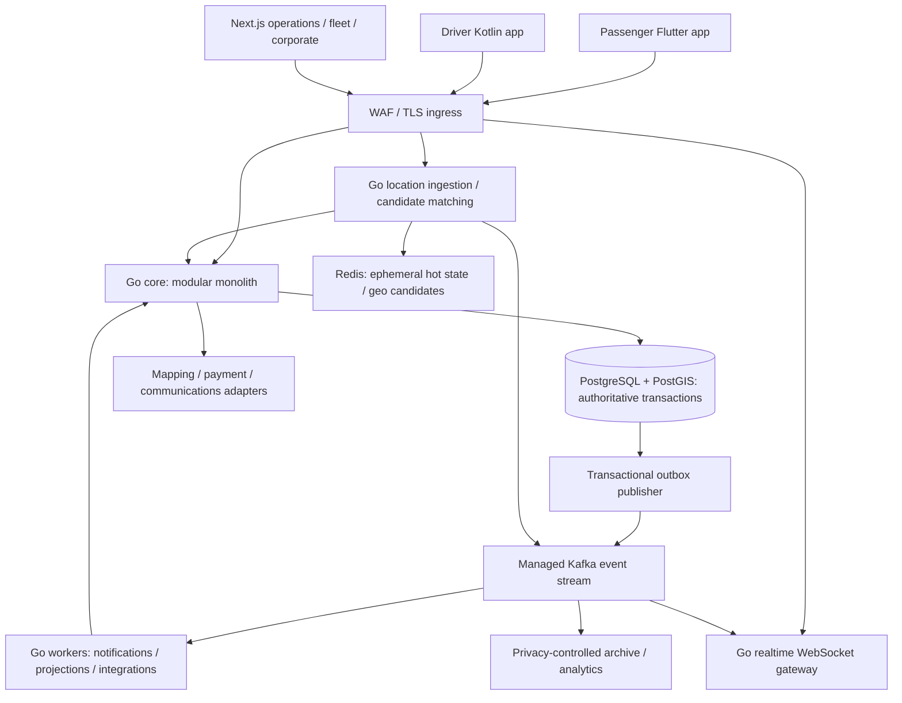

# Technical specification — Georgia ride-hailing platform

Baseline date: 2026-10-03, Asia/Tbilisi. Status: reviewable architecture baseline; no implementation or production infrastructure has been created. The user's technology direction and five-city scope are accepted planning inputs. Thresholds, performance targets, retention periods and vendor choices below are proposals requiring evidence and designated approval before launch.

This specification covers Tbilisi, Rustavi, Kutaisi, Batumi and Zugdidi. Every city retains the full product scope; activation depends on its quality, supply, operations and jurisdiction readiness. A controlled production rollout is a release mechanism, not a disposable MVP. City configuration must distinguish boundaries, eligibility, permits, fares, airport rules, language, operating hours and settlement policy. Tbilisi-specific rules must never silently become nationwide rules.

## 1. Architecture and deployment boundaries

Build a Go modular monolith for business transactions, with a few independently scalable workloads where traffic and failure profiles justify them. Domain boundaries are defined in [DOMAIN-BOUNDARIES.md](DOMAIN-BOUNDARIES.md); the future source layout is in [REPOSITORY-STRUCTURE.md](REPOSITORY-STRUCTURE.md). In-process domain interfaces inside core do not use gRPC.



| Workload | Responsibility | State it may own | Failure policy |
|---|---|---|---|
| `core` | Identity, city eligibility, quotes, trips, committed dispatch assignments, PIN checks, risk cases, ledger, payment orchestration, fleet/corporate ACL | Module-owned PostgreSQL schemas | Reject new mutations if authoritative DB is unavailable; serve clearly marked stale reads only where safe |
| `location-dispatch` | Validate samples, hot presence, spatial candidate search, route ETA/ranking, dispatch proposal computation | Redis hot state; location stream; minimal durable evidence via core command | No authoritative assignment writes; excluded stale candidates; no offers during uncertain eligibility |
| `realtime` | Authenticated socket lifecycle, authorized subscriptions, delivery cursors, bounded fanout | Ephemeral connection registry | Reconnect and fetch authoritative snapshot; socket delivery is never the only trip record |
| `workers` | Outbox publishing, inbox-protected consumers, durable schedules, PSP reconciliation, push/SMS, projections | Owner module's job/inbox/outbox tables through its application boundary | Retry with bounded backoff; quarantine and alert poison jobs; do not block live trips on analytics |
| `web-consoles` | Operations, safety, finance, fleet and corporate interfaces | No direct DB access or business source of truth | All privileged actions use core authorization and audit |

Initially these Go executables share one backend module and versioned release, not independent databases or autonomous product services. Minimum two replicas across multiple availability zones for critical stateless workloads is a launch proposal. Split a business module only after measured scaling or fault-isolation evidence, clear data ownership, independent operators and a contract migration plan. Kafka, REST, gRPC and WebSockets serve different purposes; adding network calls between every core module would increase failure paths without solving an observed problem.

## 2. Technology decisions and compatibility

Go is the server language; PostgreSQL with PostGIS is the transaction source of truth; Redis is a reconstructable hot projection; Kafka is the selected event-stream direction. External commands use REST/JSON with OpenAPI, internal workload calls use gRPC/Protobuf with explicit deadlines, realtime uses authenticated WebSockets. Web consoles use TypeScript, React and Next.js. Passenger apps use Flutter/Dart for Android/iOS; Android driver uses Kotlin/Jetpack Compose. A separate native Swift/SwiftUI driver app needs validated iOS-driver demand, staffing and operating-system capability evidence.

AWS, Docker, Terraform, ECS, OpenTelemetry, Grafana, Sentry and GitHub Actions are the operations direction. Kubernetes is deferred to an ADR supported by a measured ECS limitation and lifecycle cost. Do not select database or mobile versions merely because they are newest. The first implementation phase must record a compatibility matrix: Go/toolchain/library support; RDS engine/PostGIS version; Redis provider/license/commands; Kafka broker/client features; Terraform providers; Node/Next/React; Flutter/Dart/iOS toolchain; Android Kotlin/Compose/target SDK; observability SDK support. Pin supported stable versions, generated schemas and image digests in the repository; define a monthly vulnerability review and a tested upgrade cadence.

gRPC defaults must not be assumed to include a safe timeout: the project sets and propagates request deadlines, cancellation and bounded retries. [gRPC deadlines guide](https://grpc.io/docs/guides/deadlines/). Next.js replicas need an explicit cache/invalidation strategy, and authenticated console responses must not be cached as public content. [Next.js self-hosting guide](https://nextjs.org/docs/app/guides/self-hosting).

## 3. Authoritative data and transaction rules

Each core domain owns its tables, writes, migrations and application interfaces. One PostgreSQL cluster provides local ACID transactions for trip assignment and quote binding. Cross-module transactions require a named application coordinator and explicit participants. Cross-module direct writes are prohibited; reporting uses read models. Financial journals and privacy-sensitive identity data have separate access roles. Read replicas may serve reports, never lease acceptance or financial consistency checks.

Use UTC `timestamptz` in storage, ISO 8601 UTC on the wire and Asia/Tbilisi for user schedules and displays. A scheduled local pickup also stores IANA zone and the original local civil time. Money is integer minor units plus currency (`GEL` initially); rate calculations use deterministic decimal or fixed-point rounding and a recorded rounding policy. Opaque identifiers identify resources; authorization is required even for unguessable IDs. WGS84 coordinates have explicit longitude/latitude order; use PostGIS geography for meter-radius evidence and indexed geometry/polygons for jurisdiction boundaries with documented SRIDs. `ST_DWithin` supports geography distances in meters and index-aware radius queries. [PostGIS reference](https://postgis.net/docs/ST_DWithin.html).

Redis contains current driver session presence, location and bounded caches. GEO members do not become trustworthy merely by existing: every candidate checks a separate freshness/session-generation record, and a cleanup job removes expired members. Redis loss causes controlled rehydration and temporarily reduced dispatch; it must never erase a committed trip, ledger entry or sanction. [Redis geospatial](https://redis.io/docs/latest/develop/data-types/geospatial/), [key expiry](https://redis.io/docs/latest/develop/using-commands/keyspace/).

All state-changing application commands record actor, request ID, idempotency key, expected aggregate version, city-policy version, server decision time and relevant reasons. PostgreSQL constraints enforce cross-row uniqueness rather than application-only checks. Critical races use deterministic row-lock ordering and unique constraints; serializable transactions are reserved for demonstrated multi-row invariants and retry the whole transaction on serialization failure. [PostgreSQL constraints](https://www.postgresql.org/docs/current/ddl-constraints.html), [transaction isolation](https://www.postgresql.org/docs/current/transaction-iso.html).

## 4. Trip state machine

Trip lifecycle, payment status, safety case and scheduled-booking lifecycle are separate aggregates. A completed ride may have an unresolved payment or dispute; a payment failure must not rewind the trip.

| From → to | Authorized command / conditions | Durable effects |
|---|---|---|
| none → `REQUESTED` | Passenger or authorized corporate booker accepts unexpired quote; payment eligibility and city/service rules pass | Bind quote/policy versions, passenger, booking principal, origin/destination and payment method; create trip and outbox event |
| `REQUESTED` → `SEARCHING` | Core initializes dispatch attempt; card authorization confirmed or explicitly approved alternative payment policy; corporate budget/credit approval confirmed where applicable | New attempt generation and matching deadline |
| `SEARCHING` → `ASSIGNED` | Valid unexpired offer acceptance wins authoritative transaction | One committed driver assignment; revoke outstanding offers; increment trip version |
| `ASSIGNED` → `DRIVER_EN_ROUTE` | Assigned driver acknowledges with current generation | Driver journey start; passenger receives confirmed state |
| `DRIVER_EN_ROUTE` → `DRIVER_ARRIVED` | Core verifies arrival evidence or approved audited exception | Arrival evidence snapshot, decision reason and wait eligibility; notification intent |
| `DRIVER_ARRIVED` → `IN_PROGRESS` | Assigned driver submits valid single-use pickup PIN; approved exceptional procedure if PIN unavailable | Start time, bound assignment generation, consumed PIN proof, authorized fare-amendment state |
| `IN_PROGRESS` → `COMPLETED` | Assigned driver ends trip; server validates plausible endpoint/time and any amendment | Immutable completion evidence and fare calculation; settlement requested asynchronously |
| `REQUESTED`, `SEARCHING` → `NO_DRIVER` | Matching deadline expires with no winner | Terminal reason, release offers/preauthorization according to PSP capability |
| Pre-start states → `CANCELLED` | Passenger/driver/authorized ops; current version; versioned cancellation policy | Release reservations/assignment, fee decision with evidence, PSP reversal intent if applicable |
| `ASSIGNED`, `DRIVER_EN_ROUTE`, `DRIVER_ARRIVED` → `SEARCHING` | Explicit permitted rematch; no consumed PIN/start; passenger informed; atomic release and generation advance | Revoke old assignment/offers; retain history; bounded attempt count |
| `IN_PROGRESS` → `ABORTED` | Safety/driver/passenger trip termination workflow | End evidence, case linkage, provisional fare/settlement subject to approved policy; no automatic complete-ride charge |

Terminal states are immutable. Support decisions append adjustments or cases; they cannot rewrite history into a different ride. Offline completion/start commands retain their original client timestamp as evidence, but server state, assignment generation and PIN validity decide acceptance. A client must display pending confirmation until server acknowledgment. Never silently allow an offline driver to start an unknown trip or assume payment authorization.

Card requests first commit the trip/quote/payment intent, then call the PSP outside the database transaction. Failed authorization cancels the unstarted request under the approved fee-free payment-failure policy; an unknown outcome remains pending and cannot enter matching until resolved. Exceptions to preauthorization require a versioned finance/risk policy and do not silently fall back to cash. The matching deadline begins only when the request is eligible to search.

Every transition has an explicit allowed actor, current-state guard, aggregate-version check, financial effect and event schema. The acceptance test catalogue includes duplicate requests, cancellation racing acceptance/start/completion, late offer acceptance, reordered events, process crash at each transaction boundary and reconnection across deployment.

A standard passenger has at most one active immediate trip across `REQUESTED` through `IN_PROGRESS`, enforced with a durable passenger claim/unique active index. This protects two devices using different idempotency keys, which key-based replay protection alone cannot solve. A quote can bind to only one trip. Return the authorized current trip or a deterministic conflict on a competing request. Scheduled future bookings are separate; a corporate booker may book for distinct authorized passengers without making the booker's account the active-rider uniqueness key. Multi-passenger/delegated booking identities require an explicit contract rather than disabling this invariant globally.

## 5. Dispatch, reservations and fairness

Core holds `dispatch_attempt(trip_id, generation, status)`, `offer(offer_id, trip_id, driver_id, vehicle_id, generation, expires_at, status)`, `driver_reservation(driver_id, vehicle_id, offer_id, lease_expires_at, generation)` and `assignment(trip_id, driver_id, vehicle_id, generation, status)`. An illustrative logical model is documented here; exact migrations are designed in the contract phase.

The invariants are mandatory:

1. At most one active committed assignment per trip, driver and vehicle, enforced by unique/partial unique indexes on active assignment rows. The effective driver-vehicle relationship is validated and snapshotted at commit; a fleet transfer cannot move an active ride onto an unverified vehicle.
2. Initially at most one live offer per trip, driver and vehicle. Candidate ranking may evaluate many drivers, but core reserves and offers sequentially. Expired reservations are transitioned/replaced under lock; uniqueness must not depend on a database-index predicate containing the current clock.
3. Core alone accepts an offer, using database server time, current generation, trip state, driver/vehicle eligibility, offer status and reservation owner. Lock trip, driver and vehicle in stable order. It writes assignment, offer consumption, reservation release, state/version and outbox event in one transaction. Any contender that loses receives a deterministic conflict.
4. Generation increments invalidate old attempts and sessions. All acceptance, arrival, start and completion commands include the current assignment/attempt generation. Old workers and reconnecting clients cannot commit a stale offer.
5. A short offer lease may expire; a committed assignment does not vanish by TTL. Releasing/reassigning it requires an explicit guarded core transition. An in-progress ride cannot be reassigned because a heartbeat disappeared.
6. Redis locks, Kafka consumer partition ownership and gateway connectivity provide efficiency, never assignment correctness.

The matching pipeline filters city boundary/service category, permit and vehicle eligibility, driver shift status, current assignment/reservation, location freshness/accuracy and approved risk restrictions; it then computes short-list travel ETA through the routing adapter. Score estimated pickup time plus transparent configurable fairness terms such as idle-time credit and recent offer opportunity. Record score components, eligibility exclusions, algorithm/config version and final decision for offline fairness analysis. No hidden punishment for declining an uneconomic trip; show pickup/destination, expected fare, commission and expected driver payout before acceptance, subject to privacy and lawful product policy.

Simulate cancellation rate, pickup delay, idle time, revenue opportunity by driver cohort/city/zone, and supply starvation before changing ranking. Geography can correlate with sensitive characteristics; analysis requires privacy review. Batch parallel offers are a later optional optimization requiring simulation and the same commit invariants; they are not baseline behavior. Human safety overrides cannot bypass uniqueness or generation fencing.

Scheduled or contracted airport/intercity bookings have a separate future commitment calendar. When a named driver/vehicle is promised, reserve its time range including pickup/deadhead/turnaround buffers; prohibit overlapping confirmed commitments per driver and vehicle in an atomic core transaction. Recheck active-trip feasibility and eligibility before dispatch. Pooled-capacity bookings need explicit capacity/overbooking policy and compensation/contingency commitments; a scheduling record is never an automatic guarantee of driver availability. Future calendar reservations are distinct from current active-trip assignment uniqueness.

## 6. Location, arrival evidence and mobile connectivity

A location sample includes driver/session ID, session generation, sequence number, lat/lon, horizontal accuracy, optional reported speed/bearing, device-observed timestamp, monotonic elapsed age where available, server-received timestamp, app/device version and integrity/risk indicators. Authenticated submitter identity does not prove physical coordinates.

Validation rejects impossible coordinate ranges, wrong session ownership and repeated sequence numbers; quarantines suspicious jump/speed/accuracy samples; handles duplicate/out-of-order sequence numbers without moving the hot position backwards. Device wall-clock skew cannot make an old sample fresh: use received time, reported capture age and session-monotonic sequencing. Replayed buffered history may enrich evidence under retention policy but cannot restore current availability. Log payload-size/sequence/frequency abuse, not raw personal coordinates in ordinary telemetry.

Proposed configurable thresholds to calibrate through city field tests: active updates about every 2 seconds, waiting online about every 5 seconds; preferred matching sample age at most 10 seconds, mark stale after 30 seconds and exclude after 90 seconds; arrival sample accuracy at most 30 meters, pickup radius 75 meters, at least three eligible samples across 15 seconds. These are engineering hypotheses, not measured Georgian road behavior. City/airport geometry, road-side access, urban canyon, tunnels, high-rise entrances and pedestrian pickup exceptions require field calibration. Suspicious implied speed is a risk signal with context, not automatic account suspension.

Arrival is a server decision against a versioned pickup point/geofence, current assignment, trustworthy freshness, sustained presence and appropriate approach/access information. Core stores a minimal durable evidence snapshot with sample IDs, coordinates/accuracy/timestamps, geofence/rule version and approval reason. Driver arrival claims without sufficient evidence are `pending verification`; passenger sees this status, and fee/wait timers must not accrue as verified arrival. Arrival proof is disputable evidence. Pickup PIN is trip-bound, random, short-lived, single-use, attempt-limited and stored as a keyed digest with protected key rotation; it is not included in logs, general events or push notifications. PIN confirms possession of a trip code and limits wrong-car starts; it cannot guarantee personal safety.

Chargeable waiting additionally requires the approved passenger-notification, grace, cap and dispute policy to be satisfied. A notification intent in an outbox is not by itself evidence that the passenger-notification rule was met. Failed/unknown delivery and disconnected passenger behavior have explicit policy outcomes; no hidden default wait fee fills that gap.

Driver Android needs a visible user-initiated online workflow, required location permissions, foreground-service lifecycle handling and real-device battery/OS tests. Android background service restrictions materially affect continuous tracking. [Android foreground-service restrictions](https://developer.android.com/develop/background-work/services/fgs/restrictions-bg-start). Passenger Flutter uses native platform integration where permissions, secure storage, push or vendor SDKs require it. [Flutter platform channels](https://docs.flutter.dev/platform-integration/platform-channels). iOS driver feasibility must test the actual Core Location background model. [Apple background location](https://developer.apple.com/documentation/corelocation/handling-location-updates-in-the-background).

All mobile clients maintain a bounded encrypted local command queue, session-generation record and last confirmed trip version. Reconnection fetches `GET /v1/trips/{id}/snapshot`, then resumes authorized realtime updates from a cursor. Snapshot includes state/version, assignment generation, fare/quote/amendment versions, server time, permitted next actions and payment status. Client rejects older aggregate versions; cursor gaps trigger another snapshot. Push/SMS helps wake or contact users, but cannot guarantee instant delivery. Recovered stale driver connectivity requires fresh location and core reconciliation before new offers.

Do not persist plaintext PIN, payment credentials or identity-document payloads in the command queue. A PIN-related offline interaction uses an approved short-lived protected intent and requires server revalidation; an expired PIN triggers recovery rather than an offline bypass. Device compromise and queue retention are included in mobile security tests.

## 7. Quotes, fares and financial ledger

Upfront quote is immutable and versioned: `quote_id`, expiration, city/service, pickup/dropoff/stops, route-provider provenance, licensed route facts, currency, fare components, commission policy, taxes as approved, toll/airport treatment, surge rule/cap, cancellation/wait rules and rounding. Acceptance binds this snapshot. Normal traffic or a driver's chosen detour does not silently increase a locked fare. Destination/stops/service changes require a new explicit passenger amendment with delta, reason and version; a rejected amendment preserves the original agreed service or invokes a documented termination/dispute workflow. Any permitted wait/toll change must have been disclosed in the accepted policy and evidenced. Never surprise a rider with a post-ride surge version.

Fare calculation is deterministic, replayable and independent of mapping-provider availability after booking. Where provider terms restrict retaining route geometry or responses, store only legally permitted billing facts and customer-selected coordinates, under confirmed licensing. A provider outage may use a previously approved zone tariff/fallback quote with clear disclosure or make the service temporarily unavailable; it cannot invent ETA certainty.

Maintain an append-only double-entry journal with integer minor-unit amounts, currency, balanced transaction batches, immutable business-event reference, posting-rule version and idempotent effect ID. Accounts, taxes, principal-versus-agent revenue recognition, settlement ownership, driver legal status and receipt/invoice issuer need accountant/legal approval before real money. Rider fare, driver earnings, platform commission, promotions, tips, refunds, chargebacks, PSP fees and cash debt are separate facts. No cash float, wallet, escrow or stored-value feature is assumed legally available.

Journal entries use pseudonymous subject/contract references and the minimum approved financial facts; phone numbers, identity-document scans and raw location do not belong in immutable postings. Personal identity mapping is managed separately under its lawful retention/deletion schedule. Snapshot earning party, fleet/driver beneficiary agreement and applicable settlement terms at the economic event; a subsequent membership change cannot rewrite old payables or reroute them silently.

Card flow separates intent, authorization, capture, settlement and reconciliation; final trip fare and payment state may diverge temporarily. Persist intent before calling PSP; use PSP idempotency or merchant reference when supported; on timeout mark outcome `UNKNOWN`, query provider and reconcile before a second charge. Verify webhook authenticity using documented provider method, deduplicate, and retrieve authoritative payment details as necessary. Out-of-order callbacks cannot downgrade settled state. A PSP transaction and PostgreSQL commit are not atomic; use durable jobs and a recovery state machine. Local TBC documentation exposes recurring/preauthorization flows, but activation and ride-hailing merchant suitability remain commercial gates. [TBC recurring payment API](https://developers.tbcbank.ge/reference/post_v1-tpay-payments-execution), [TBC merchant FAQ](https://developers.tbcbank.ge/docs/e-commerce-faq).

Cash flow records cash owed and driver-reported collection separately; PSP settlement is never fabricated for a cash ride. Commission receivables, debt limits and collection require approved terms. Refunds and dispute corrections post reversals/adjustments referencing original entries; support cannot edit or delete a journal. Reconcile trip totals → journal → PSP/bank statements → driver payout, by currency and settlement batch, with a daily exception queue and maker/checker approval for payouts/large adjustments. Payout retries must not create duplicate bank transfers. Corporate invoice debt is a distinct credit policy, with spending ceilings and approved collection process.

Partial/split refunds allocate fare, commission, tax, promotion, tip and beneficiary recovery under an approved rule version. Provider split settlement and refund capabilities are verified contractually; already-paid driver/fleet amounts create an explicit approved adjustment/receivable process, never an unexplained negative payout. Multiple callbacks or a replay cannot apply an adjustment twice. Historical event replays rebuild isolated projections; they do not resend notifications, charge cards, issue refunds or reexecute payouts without a narrowly approved recovery operation.

## 8. API and event contracts

REST uses `/v1`, OpenAPI generated clients, stable enum/code definitions and additive compatible changes. Commands require bearer identity, resource relationship authorization, request ID, `Idempotency-Key` and expected aggregate version where races matter. The server derives actor/tenant from validated membership, not a client-supplied unrestricted tenant header. gRPC uses workload identity/TLS, bounded message sizes, deadlines and trace propagation. Realtime subscriptions authorize each trip/tenant and recheck on membership changes.

Proposed error envelope, documentation example only:

```json
{"error":{"code":"ASSIGNMENT_STALE","message":"This offer has expired.","request_id":"req_example","retryable":false,"details":{"current_trip_version":14}}}
```

401 is invalid session, 403 unauthorized relationship, 404 conceals inaccessible objects where appropriate, 409 state/version or idempotency-payload conflict, 422 business/validation rejection, 429 limit with `Retry-After`, 503 temporary unavailability. Messages support Georgian/English localization while codes remain stable. Never expose stack traces, private risk scores, other tenants or PSP secrets. Read retries and retryable mutations use exponential backoff with jitter and a bounded deadline; mutations retry with the same key and payload. Do not retry business rejection or create a replacement payment intent on uncertainty.

Proposed idempotency policy: key scope is authenticated principal + operation + resource where applicable; canonical payload hash must match. Store result atomically with effect; identical retry returns the original effect/result subject to current access checks. Generic command-response records retained at least 7 days (engineering proposal); trip creation/start/completion/assignment financial effect references remain unique for the business record's approved retention. PSP/bank references use permanent uniqueness for their retained settlement records. After short cache expiry, the server still rejects a duplicate business effect. Store no secret PIN or full payment data in cached responses; old offer keys cannot make an expired offer valid. Client key reuse across a different operation is rejected or properly isolated, never mistaken for a new charge.

Kafka event example, documentation only:

```json
{
  "event_id":"evt_example","event_type":"trip.assigned","schema_version":1,
  "aggregate_type":"trip","aggregate_id":"trip_example","aggregate_version":14,
  "city_id":"kutaisi","occurred_at":"2026-10-03T17:00:00Z",
  "correlation_id":"req_example","causation_id":"cmd_example",
  "data":{"assignment_id":"asg_example","assignment_generation":3,"driver_ref":"drv_pseudonymous"}
}
```

Transactional outbox: business row change and event row commit in the same PostgreSQL transaction; publisher may resend. Consumer inbox: effect and `(consumer, event_id)` record commit atomically before offset acknowledgment. Dedupe retained long enough to cover the entire allowed replay horizon; older replays require a documented rebuild into a clean projection or business-reference uniqueness. Partition trip events by `trip_id`, driver telemetry by driver/session; there is no total order across partitions. Aggregate version detects gaps, and consumers fetch owner snapshots rather than inventing ordering. Do not include PIN, identity documents, exact personal coordinates or unconstrained PII in general business topics. Security/finance topics have separate ACLs.

Kafka transactions/producer idempotency may improve Kafka-to-Kafka processing, but do not provide end-to-end exactly-once effects in PostgreSQL, a bank or a PSP. [Apache Kafka delivery semantics](https://kafka.apache.org/41/design/design/). Critical command success cannot depend on analytics, SMS or consumer lag. A bounded outbox allows continuing core transactions during a Kafka outage; capacity alarm and admission policy prevent disk exhaustion. Essential projections and realtime use a controlled core snapshot/poll fallback. Location acknowledgments distinguish accepted-hot-state from durably archived evidence; raw telemetry loss must not erase arrival/completion evidence already committed in core.

Before selecting MSK Provisioned, MSK Serverless or another compatible managed Kafka provider, benchmark the Go client, auth, throughput, partitions, retention, replay and failure recovery, and obtain a regional 30-day total-cost model. Include idle cluster/partition charges, storage, ingress/egress, consumer fanout, cross-AZ transfer, NAT/private networking, registry/connectors, observability, environments and support. Serverless is not a promise of zero idle cost. [Amazon MSK pricing](https://aws.amazon.com/msk/pricing/). Kafka remains the architectural direction; any initial deferral requires an explicit ADR and user decision, durable event contracts and a tested migration—not an unnoticed queue substitution.

## 9. Security, tenant isolation and safety operations

Use OIDC-capable identity infrastructure selected by Georgian SMS delivery, cost, recovery, MFA and vendor review. Passenger/driver phone OTP has rate limits and anti-enumeration; administrative users have phishing-resistant MFA, least privilege and audited session recovery. Rotating mobile refresh tokens use OS secure storage; browser sessions use secure/HttpOnly cookies with CSRF protection. Phone numbers, bank payout changes and recovery need step-up checks and fraud cooling policy. Access control uses role + relationships + tenant/city/purpose attributes, enforced server-side at every boundary. [OWASP authorization guidance](https://cheatsheetseries.owasp.org/cheatsheets/Authorization_Cheat_Sheet.html).

Fleet administrators can manage only current fleet memberships/authorized vehicle records and approved finance views. Corporate administrators see approved business bookings, policy and invoices; they cannot browse an employee's private rides or unrelated driver route history. Membership is effective-dated, so a fleet transfer does not retroactively expose another fleet's private records. Tenant-scoped foreign keys/queries, object-level policy tests and PostgreSQL RLS are defense in depth; runtime roles must not be owners/superusers or bypass RLS. Background jobs, exports, WebSockets, object-storage signed links and caches require the same tenant/purpose authorization. [PostgreSQL row security](https://www.postgresql.org/docs/current/ddl-rowsecurity.html).

| Threat | Required mitigation / evidence |
|---|---|
| Offer/PIN/command replay | Session/assignment generation, short expiry, version guards, one-use PIN and durable idempotent effects; concurrent replay test |
| GPS spoof, replay, fake arrival | Sequence/capture-age checks, server evidence, device integrity as one signal, approach plausibility and support review; no device-attestation claim of true GPS |
| Account takeover / SIM swap | Rate limits, recovery review, step-up bank/phone change, admin MFA, payout cooling; account recovery drill |
| Tenant or trip data leak | Deny-by-default object/tenant checks, RLS and cross-tenant API/socket/export tests; no PII in public caches |
| Payment/webhook fraud | Durable intent, provider verification, amount/currency/reference check, reconciliation, maker/checker payout approval |
| Insider surveillance or adjustment abuse | Purpose-limited access, audit and export controls, break-glass approval/review, tamper-evident access logs |
| Location/API denial of service | Quotas per identity/session/city, bounded queues/payloads, backpressure and degradation; overload tests |
| Supply-chain/secrets compromise | Dependency/image scanning, SBOM, signed/digest-pinned artifacts, workload IAM, secret rotation, isolated build/deploy roles |

Device integrity APIs are risk inputs; they cannot prove the driver identity, unspoofed position or safety of a trip. [Play Integrity overview](https://developer.android.com/google/play/integrity/overview). Risk engine initially uses versioned deterministic rules and reason codes. Outcomes are allow, request verification, temporary reversible restriction, or refer to staffed review. Permanent sanctions require documented evidence, human review and an appeal pathway, with proportional emergency restrictions where necessary. Risk, pricing and dispatch decisions must be auditable independently.

Safety cases track report source, severity, affected parties, timestamps, response owner, escalation, lawful evidence access and follow-up. The launch requires staffed incident handling, in-app access to emergency calling, approved escalation procedures and drills. The app must not imply an established automated connection to Georgian emergency services without a confirmed agreement. Trip sharing uses revocable unguessable tokens, short expiry and minimal disclosed data.

## 10. Proposed privacy and retention implementation

This is an engineering schedule for legal/DPO approval, not a statement of Georgian statutory periods. Purposes, legal bases, controller/processor roles, international transfer conditions, deletion/access requests and DPIA must be approved before collecting real data. Provider license constraints may impose stricter retention.

| Category | Proposed duration / handling | Approval still needed |
|---|---|---|
| Hot precise driver position/presence | 90-second freshness ceiling for availability; key cleanup within 5 minutes; no offline tracking | Actual permission/purpose and field reliability |
| Raw driver telemetry | Up to 7 days operational replay; delete or irreversibly aggregate afterward | Necessity, category lawful basis, incident exceptions |
| Trip-level arrival/start/end evidence | Proposed 90 days, limited purpose access; case-bound hold only when approved | Dispute/safety need, retention and legal hold process |
| Rider/driver trip history and fare records | User-facing proposal 24 months; precise route stripped earlier unless necessary | Business/legal retention and location minimization |
| Payment journals, tax/settlement documents | Length deliberately unset; accountant/legal schedule required | Statutory and contract obligations, record segregation |
| Identity/permit/KYC documents | Keep only approved eligibility requirements during relationship + approved offboarding period; no arbitrary date | What platform is entitled/required to collect |
| Support/safety evidence | Case-class schedule deliberately unset; periodic necessity review | Sensitive-data rules, incident/litigation procedure |
| Operational logs/traces | Proposed 30 days logs / 14 days traces; redact PII and secrets at source | Investigative need and provider settings |
| Security audit logs | Proposed 180 days, restricted access | Proportionality and legal obligations |
| Backups | Proposed rolling 35 days; restore reapplies deletion tombstones before normal service | Legal policy, restore design, off-site region |

Deletion propagates to primary tables, Kafka topics/projections, archives, search, vendors and scheduled exports; backups use expiry plus restore-time deletion replay. A legal hold is explicit, narrow and reviewed, with a responsible owner and end criterion. Never call pseudonymous telemetry anonymous while it remains linkable. Sentry session replay is disabled initially for trip/finance screens until privacy review; OTel/Grafana/Sentry exporters redact location, phone, PIN, tokens and card data.

## 11. AWS deployment, reliability and observability

Use a single selected EU or nearby AWS region after actual Georgia mobile RTT, service availability, residency/transfer review and cost comparison; region is not pinned yet. Production VPC spans at least two AZs, with three where region/cost and broker topology support it. Private core/data workloads, TLS ingress, WAF quotas, task-level IAM, encrypted storage/backups, Secrets Manager and no public DB/Redis/broker endpoints. ECS task distribution and deployment rollback must be explicitly configured and tested. [ECS availability-zone balancing](https://docs.aws.amazon.com/AmazonECS/latest/developerguide/service-rebalancing.html), [deployment circuit breaker](https://docs.aws.amazon.com/AmazonECS/latest/developerguide/deployment-circuit-breaker.html).

Initial database recommendation: RDS PostgreSQL Multi-AZ with a compatible PostGIS extension, PITR, encrypted snapshots and restore runbooks. Select Aurora only after cost/performance/extension evidence. Redis managed HA topology is selected after required commands/license review; Kafka managed broker topology after ADR-003 gate. S3 holds approved documents/evidence with separate buckets/policies, upload scanning, short authorized signed URLs, encryption and lifecycle. Production, staging and CI/dev have separate AWS accounts or equivalent documented isolation; no production PII in fixtures. RDS supports Multi-AZ and PITR, but these features do not certify project recovery targets. [RDS PostgreSQL guide](https://docs.aws.amazon.com/AmazonRDS/latest/UserGuide/CHAP_PostgreSQL.html).

Terraform state uses encrypted remote storage and lock/concurrency controls, limited IAM and independent backup; secrets in plans/state remain sensitive even when output is masked. [Terraform sensitive data](https://developer.hashicorp.com/terraform/language/manage-sensitive-data). GitHub Actions obtains short-lived AWS credentials through scoped OIDC trust; production environments have appropriate release controls and artifact promotion from a tested immutable image. [GitHub OIDC for AWS](https://docs.github.com/en/actions/how-tos/secure-your-work/security-harden-deployments/oidc-in-aws).

OpenTelemetry instruments Go, web and supported clients through a collector; Grafana dashboards show RED metrics, DB waits/pool saturation, dispatch conflicts, stale drivers, Kafka/outbox/inbox lag, ledger imbalance, uncertain PSP outcomes and safety queue age. Sentry captures scrubbed errors. Trace sampling keeps errors and slow operations without treating a trace as financial audit evidence. [OpenTelemetry Collector](https://opentelemetry.io/docs/collector/).

## 12. Proposed capacity, SLO and recovery acceptance

Numbers below are synthetic engineering acceptance targets for one shared five-city deployment, not demand forecasts, promises or results. Replace them after supply research, field trials and measured benchmarks. Test skewed load in one city/zone; balanced averages hide hot partitions and popular pickup bottlenecks.

| Dimension | Proposed benchmark envelope |
|---|---|
| Online drivers | 5,000 sustained; 10,000 peak simulation |
| Location ingest | 2,500 samples/s sustained at a hypothetical all-active 2-second cadence; 5,000/s peak; 10,000/s for a 60-second reconnect burst |
| Concurrent sockets | 20,000 authenticated connections, 100,000 targeted messages/s burst with bounded queues; no global broadcast |
| New bookings | 25/s sustained, 100/s for a 60-second burst; additional lifecycle commands and read requests total 500/s for tests |
| Worker replay | 24-hour synthetic backlog drained within 2 hours without degrading command SLOs |
| Operations unit | One actively staffed safety/ops handling slot = one trained person able to own one urgent case at a time; automated dashboards or engineers do not count |

| Metric | Proposed target and definition |
|---|---|
| Critical API availability | 99.95% over a rolling 30 days for valid authenticated quote/booking/transition requests; count dependency-caused technical failures and maintenance; legitimate business rejections reported separately |
| Core command latency | p95 ≤ 300 ms, p99 ≤ 1 second measured at server ingress; external PSP/route calls have separately reported bounded budgets |
| Candidate generation | p95 ≤ 1 second to return eligible ranked candidates at benchmark load; human acceptance/matching success is a separate marketplace KPI |
| Location freshness | p95 accepted sample-to-hot-projection ≤ 500 ms and socket fanout ≤ 2 seconds under healthy load; stale/OS-delayed samples measured independently |
| Correctness | Zero duplicate active trip/driver/vehicle assignments, duplicate payment effects, unbalanced journal batches or tenant authorization failures in stress/fault tests; any production occurrence is a high-severity incident |
| In-region recovery | Proposed RPO ≤ 5 minutes / RTO ≤ 30 minutes for core disaster restore; planned transaction DB failover separately tested; Redis rebuild ≤ 5 minutes after source recovery |
| Regional disaster | Proposed RPO ≤ 1 hour / RTO ≤ 4 hours using legally approved cross-region backups and rehearsed infrastructure restore; no active-active regional trip writes |

RPO/RTO are measured by injecting failures and comparing committed trip/journal evidence, not by reading provider marketing. AZ failure, DB failover, full backup restore, corrupted deployment rollback, broker outage/replay, Redis flush, PSP unknown outcome and mobile reconnect each have a dated drill with results. Redis loss must not lose assignment; Kafka loss must not lose an already committed business event until outbox retention/recovery boundaries. Region recovery must reconcile PSP/bank effects and reapply privacy deletion tombstones before reopening mutations.

A restored database may lack a recently successful external capture or payout. Restore recovery quarantines uncertain intents, queries stable PSP/bank merchant references and reconstructs only verified missing effects with audit evidence; it never blindly replays an old charge/payout queue. Missing financial records or an unavailable authoritative external query block the affected money flow for manual resolution. Accountant/legal must approve whether these proposed RPOs satisfy record obligations; stricter finance requirements change backup/replication design and cost before launch.

## 13. Gates before implementation and before production

Contract/design gate: approve domain ownership, state transition catalogue, dispatch invariants, fare/amendment/ledger rules, five-city policy matrix, privacy data map, threat model, version compatibility and test plan. Document unresolved principal/agent, mapping storage, PSP settlement and airport permissions as blockers for the affected real-money capability, not assumptions silently converted into code.

Implementation gate: named repository/team owner, protected Git remote, approved credentials strategy, dependency versions and CI baseline; no external account, merchant contract or AWS spend is implied by this document. Begin with executable contract and invariant tests plus production foundations, then end-to-end vertical workflows with all required controls.

Production gate: measured load/fault and mobile field evidence; signed operational/legal/privacy/payment decisions; restored backups and reconciled ledgers; support/safety coverage for all operating hours; app-store policy completion; supply/quality readiness separately recorded for all five cities; rollout, rollback and incident runbooks. The feature set remains full scope throughout.

The associated roadmap reserves public activation for phase 12 after full-scope capability and production qualification. Earlier sandbox, shadow and staffed field work must obey their own approved legal/data/payment scope; a test flag is not authorization to collect live personal data or move money.
